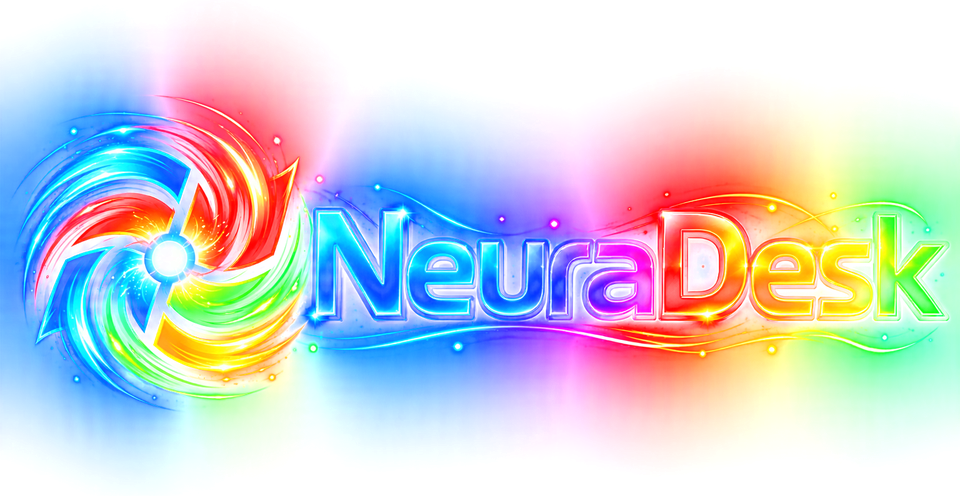

<p align="center">
  
</p>

<p align="center">
  <b>Un bureau façon Unity et GNOME, posé sur Windows.</b><br>
  Rust · Direct3D 11 · CEF — licence GPL-3.0-or-later
</p>

---

NeuraDesk remplace l'aspect de la barre des tâches de Windows par un
environnement de bureau complet, **sans modifier Windows** : il se pose
par-dessus le bureau, et le quitter rend Windows tel qu'il était.

*English summary: NeuraDesk is a Unity/GNOME-style desktop shell overlay for
Windows 10/11 — a magnifying side dock, a top bar, a bottom window bar, icon
zones and some forty built-in applets. Written in Rust, rendered with
Direct3D 11, panels in HTML through CEF. The UI and the documentation are in
French. Licensed under the GNU GPL v3 or later.*

## Ce que fait NeuraDesk

- **Le dock** : une bande d'icônes à gauche, avec effet de loupe au survol,
  indicateurs de fenêtres ouvertes, dossiers, sous-docks et zones que l'on
  organise à la souris.
- **La barre du haut** : horloge et calendrier, réseau, son, notifications
  (les toasts Windows y sont repris), zone de notification, bureaux virtuels
  avec aperçus.
- **La barre du bas** : les fenêtres ouvertes, réordonnables.
- **Le Dash** : la recherche et le lancement des applications.
- **Les applets intégrées** : notes, presse-papiers avec historique,
  calendrier, météo, terminal (onglets administrateur), capture d'écran et
  éditeur d'image à calques, enregistrement d'écran, scanner et
  reconnaissance de texte, minuteur, surveillance de machines, serveurs
  SSH/SFTP, sélecteur de couleurs, kaomojis, caractères spéciaux, mode nuit,
  clavier visuel, Voicemeeter, automatisations, et quelques jeux (2048, Cinq
  ou plus, Quadrapassel, Lights Off).
- **L'apparence** : styles inspirés de GNOME, KDE, Unity, elementary,
  COSMIC…, thèmes d'icônes, couleur par panneau et par menu, textures,
  dégradés animés, effets d'ouverture et de fermeture des fenêtres.

## Installer (version portable)

Les archives portables sont publiées dans les [**Releases**](https://github.com/axalox/NeuraDesk/releases) du dépôt :
extraire l'archive, lancer `neuradesk.exe`. Le moteur d'affichage (CEF) et
le runtime Visual C++ sont fournis.

Certains programmes facultatifs débloquent une applet précise (NAPS2 pour le
scanner, Everything pour la recherche de fichiers, VLC, Voicemeeter…) : voir
[`a_faire_installation_logiciels.html`](a_faire_installation_logiciels.html).

Configuration requise : **Windows 11**, ou **Windows 10 22H2**, en 64 bits.

## Compiler depuis les sources

### Prérequis

- **Rust** stable, toolchain `x86_64-pc-windows-msvc` ([rustup](https://rustup.rs)).
- **Visual Studio Build Tools** avec la charge *Développement Desktop en C++*
  (éditeur de liens MSVC et SDK Windows).
- **CMake** et **Ninja** dans le `PATH` : la crate `cef-dll-sys` compile
  localement la couche C++ `libcef_dll_wrapper`.
- Une connexion Internet au **premier** build : la distribution CEF
  (Chromium) est téléchargée automatiquement. Pour réutiliser une copie
  locale, définir `CEF_PATH`.

### Construire et lancer

```powershell
cargo build --release
.\target\release\neuradesk.exe
```

Les tests :

```powershell
cargo test --release --bin neuradesk
```

> ⚠️ Si le dépôt est dans un dossier synchronisé (OneDrive…), la
> synchronisation peut verrouiller `libcef.dll` dans `target\` et faire
> échouer le build (`os error 1224`). Placer alors la cible ailleurs, par
> exemple dans un `.cargo/config.toml` local :
> `[build] target-dir = "C:/build/neuradesk"`.

### Les composants à part

- `window-hook/` : la DLL qui anime l'ouverture et la fermeture des fenêtres
  (facultative). Elle se construit séparément, voir
  [`window-hook/README.md`](window-hook/README.md) ; `build.rs` la copie à
  côté de l'exe si elle existe.
- `shell-hook/` : expérimentation d'observation du shell, hors du binaire.
- `tools/` : outils de régénération des données embarquées (table des fêtes).

## Organisation du code

```
src/
  main.rs, app.rs   point d'entrée, boucle principale
  gfx/              Direct3D 11 : périphérique, swap chain, rendu, textures
  ui/               modèle du dock, des barres et des zones
  win32/            fenêtres, intégration Windows, et un module cef_* par panneau
assets/popups/      les pages HTML/CSS/JS des panneaux et des applets
TopbarIcons/        les thèmes d'icônes
son/                les sons d'alarme
docs/plans/         les notes de conception
```

## Contribuer

Voir [`CONTRIBUTING.md`](CONTRIBUTING.md). Les rapports de bogue et les
propositions passent par les *Issues*.

## Licence

NeuraDesk est un logiciel libre : vous pouvez le redistribuer et le modifier
selon les termes de la **GNU General Public License**, publiée par la Free
Software Foundation, **version 3 ou (à votre choix) toute version
ultérieure**. Il est distribué dans l'espoir qu'il sera utile, mais **SANS
AUCUNE GARANTIE**. Texte intégral : [`LICENSE`](LICENSE).

Le binaire embarque des composants tiers sous leurs propres licences :
icônes (Iconsax, Keyline, Fluent Emoji, Energy Icons, Phosphor — MIT),
police Nordwand Mono (SIL OFL 1.1), xterm.js (MIT), Chromium/CEF (BSD-3),
plus libVLC (LGPL-2.1+ et GPL-2.0+) et GStreamer (LGPL-2.1+) dans l'archive portable. Leurs
mentions sont dans [`THIRD-PARTY-NOTICES.md`](THIRD-PARTY-NOTICES.md) et
celles des crates Rust dans [`THIRD-PARTY-CRATES.txt`](THIRD-PARTY-CRATES.txt).

Chaque archive portable correspond à un tag `portable-AAAA-MM-JJ` de ce
dépôt, qui en contient les sources complètes.
